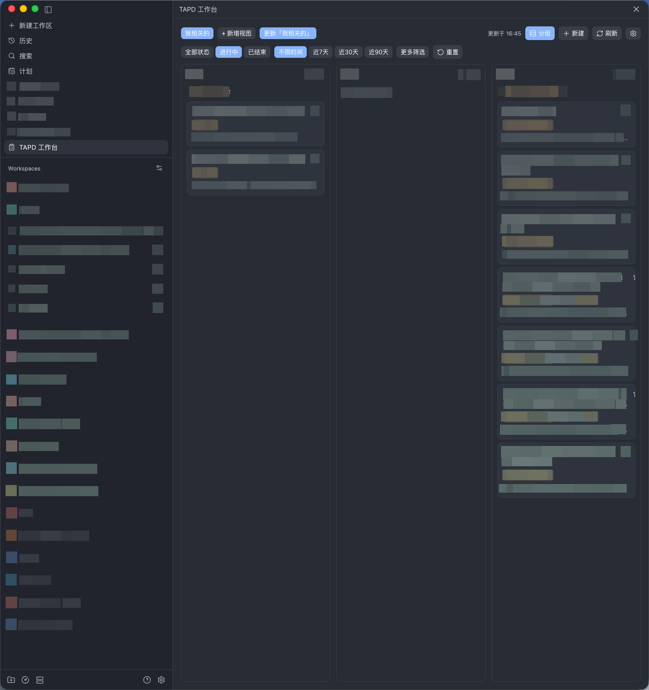

# Paseo TAPD Workbench

A Paseo plugin that brings TAPD (stories, tasks, and bugs) into your Paseo workspace: a three-column board, reusable views, agent dispatch, and comment/status write-back.



## Features

- Aggregate tab (stories / tasks / bugs side by side, with collapsible status groups) plus one tab per type with a status-column kanban; selectable columns, colored status labels, and starred pinning
- Views as reusable filter presets: built-in "Related to me" (owner, creator, developer, participator, watcher, or commenter, plus linked-task involvement), plus keyword, owner, creator, status scope, iteration, updated-within, priorities, bug severities, labels, and any field from the workspace's TAPD field definitions
- Detail window with description, comments, open-in-TAPD, and copy-link
- Dispatch to an agent: pick a repository and provider/model; the plugin creates a worktree workspace and starts an agent preloaded with the item snapshot, then tracks it from the card
- Write back to TAPD: comments (plain text converted to HTML), workflow status changes, and new item creation
- Attachment source: search TAPD items while composing a prompt and attach a snapshot
- Agent binding: pick an agent from the item detail window to link it to the item; the bound agent receives a short follow-up notice with the item snapshot, and agent sessions receive the TAPD environment variables (when not already defined) so a linked agent can query and update TAPD
- Update check: when the registry pins a newer version, the workbench shows a top banner with the update command (`paseo plugin update tapd-workbench`)

## Install

Requires Paseo >= 0.11.2 (daemon and client).

```bash
# from GitHub
paseo plugin add git:CasonMo/paseo-tapd

# or from any Git source
paseo plugin add git:<repo-url>
```

After installing, enable the plugin under Settings → Plugins and configure it:

- API Token: TAPD OpenAPI token (falls back to the daemon env var `TAPD_TOKEN`)
- Project IDs: TAPD `workspace_id` list (falls back to `TAPD_WORKSPACE_IDS`)

Use "Test connection" in the plugin settings to verify.

## Agent binding

Pick an agent from the item detail window to link the item to that conversation. The bound agent receives a short follow-up notice with the item snapshot, and agent sessions receive the TAPD connection variables when they are not already defined so the agent can query and update TAPD.

## Security

- No credentials are stored in this repository. The token is used only by the daemon-side plugin, as the TAPD `Authorization` header.
- Prefer environment variables (`TAPD_TOKEN`, `TAPD_WORKSPACE_IDS`). A token saved in the plugin settings is stored as plain JSON on the daemon host and is readable by the connected settings interface.
- The plugin calls only the TAPD OpenAPI. The API base URL and web link base can be overridden per daemon with `TAPD_API_ENDPOINT` and `TAPD_SITE_URL`.
- Reads cover every configured project. Write operations (comments, status changes, item creation) target the first configured TAPD project.
- Agent dispatch sends the item snapshot (used as the prompt) to the selected agent provider through the Paseo SDK.
- Update checks fetch the public registry record and this repository's manifest at the pinned commit from GitHub (`raw.githubusercontent.com`, falling back to `api.github.com`). No credentials are attached and no user data is sent; the result is cached for an hour.

## Development

```bash
npm install
npm run typecheck
npm run lint                                       # React Hooks rule check
paseo plugin install /absolute/path/to/this/repo   # install from a local directory
paseo plugin reload tapd-workbench                 # reload after edits
```

## License

MIT

---

# 中文说明

一款把 TAPD（需求、任务、缺陷）带进 Paseo 工作区的插件：三栏并排看板、可复用视图、派给 Agent、评论与状态回写。


## 功能

- 聚合页签（需求 / 任务 / 缺陷三栏并排，按状态分组可折叠）+ 每个类型一个独立页签的状态列看板；列可自选、状态标签带颜色、卡片可加星置顶
- 视图 = 可复用的过滤预设：内置「我相关的」（负责人、创建人、开发、参与、关注或评论过，以及关联任务涉及我），另支持关键词、负责人、创建人、状态范围、迭代、最近更新时间、优先级、缺陷严重程度、标签，以及工作区 TAPD 字段定义中的任意字段
- 单据详情浮窗：描述、评论、在 TAPD 中打开、复制链接
- 派给 Agent：选择仓库与 provider/model；插件创建 worktree 工作区并启动一个预置了单据快照的 Agent，之后可从卡片追踪
- 回写 TAPD：评论（纯文本自动转 HTML）、工作流状态变更、新建单据
- 附件源：撰写提示词时搜索 TAPD 单据并附上快照
- Agent 绑定：在单据详情浮窗中选择一个 Agent 关联该单据；绑定后该 Agent 会收到一条带单据快照的简短跟进提示，Agent 会话会在未定义时注入 TAPD 环境变量，使其可直接查询与更新 TAPD
- 更新检查：registry 固定到新版本时，工作台顶部显示带更新命令的横幅（`paseo plugin update tapd-workbench`）

## 安装

需要 Paseo >= 0.11.2（daemon 与 client）。

```bash
# 从 GitHub
paseo plugin add git:CasonMo/paseo-tapd

# 或任意 Git 源
paseo plugin add git:<repo-url>
```

安装后在 设置 → 插件 中启用并配置：

- API Token：TAPD OpenAPI token（未填写时回退 daemon 环境变量 `TAPD_TOKEN`）
- 项目 ID：TAPD `workspace_id` 列表（回退 `TAPD_WORKSPACE_IDS`）

可在插件设置中用「测试连接」验证。

## Agent 绑定

在单据详情浮窗里选择一个 Agent，把单据关联到该会话。绑定的 Agent 会收到一条带单据快照的跟进提示；Agent 会话在未定义时会收到 TAPD 连接环境变量，便于 Agent 直接查询与更新 TAPD。

## 安全

- 本仓库不存储任何凭据。Token 仅由 daemon 侧插件使用，作为 TAPD 的 `Authorization` 头。
- 优先使用环境变量（`TAPD_TOKEN`、`TAPD_WORKSPACE_IDS`）。保存在插件设置中的 token 以明文 JSON 存于 daemon 主机，可被已连接的设置界面读取。
- 插件只调用 TAPD OpenAPI。API 基地址与网页链接基地址可用 `TAPD_API_ENDPOINT`、`TAPD_SITE_URL` 按 daemon 覆盖。
- 读取覆盖所有已配置项目。写操作（评论、状态变更、建单）只作用于第一个配置的 TAPD 项目。
- 派给 Agent 时，单据快照（作为提示词）经 Paseo SDK 发送给所选的 agent provider。
- 更新检查从 GitHub 拉取公开的 registry 记录与固定提交处的本仓库清单（`raw.githubusercontent.com`，失败时回退 `api.github.com`），不附带凭据、不发送用户数据，结果缓存一小时。

## 开发

```bash
npm install
npm run typecheck
npm run lint                                       # React Hooks 规则检查
paseo plugin install /本仓库的绝对路径               # 从本地目录安装
paseo plugin reload tapd-workbench                 # 修改后重新加载
```

## 许可证

MIT
